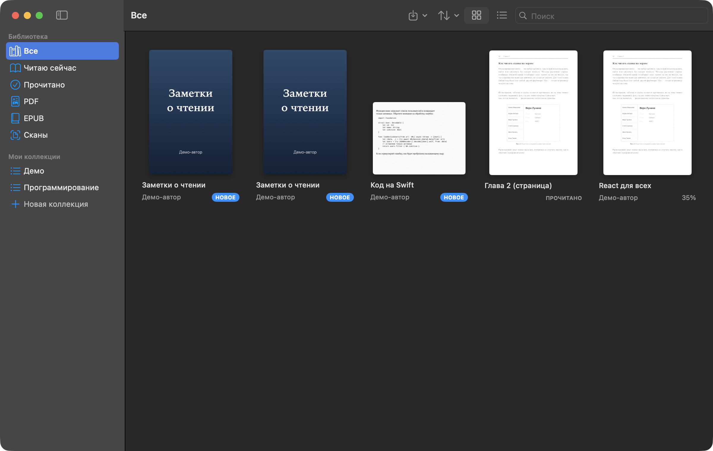
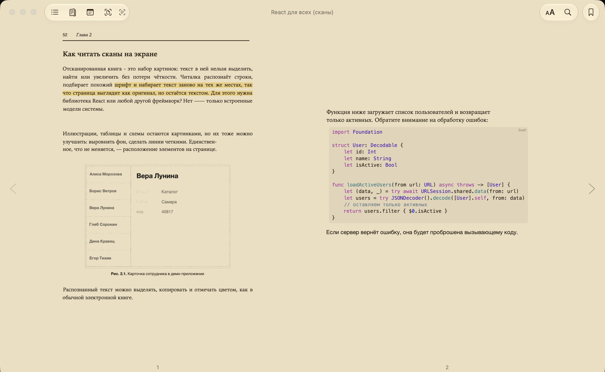
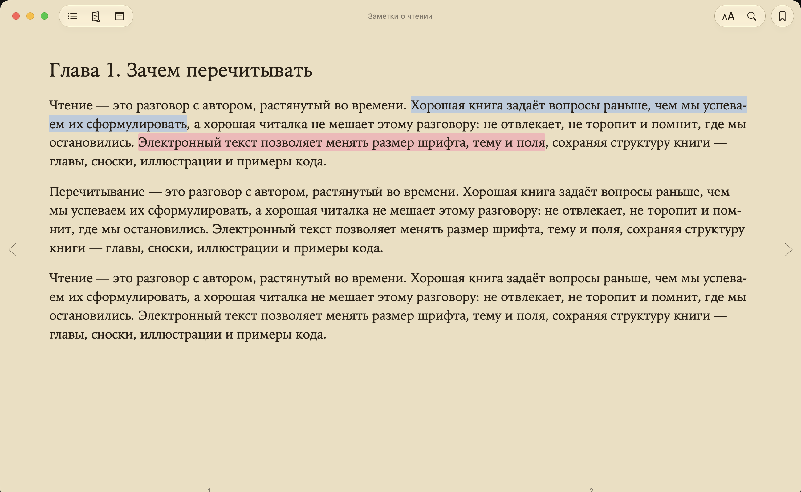
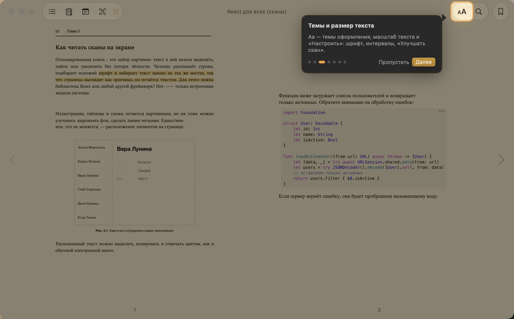
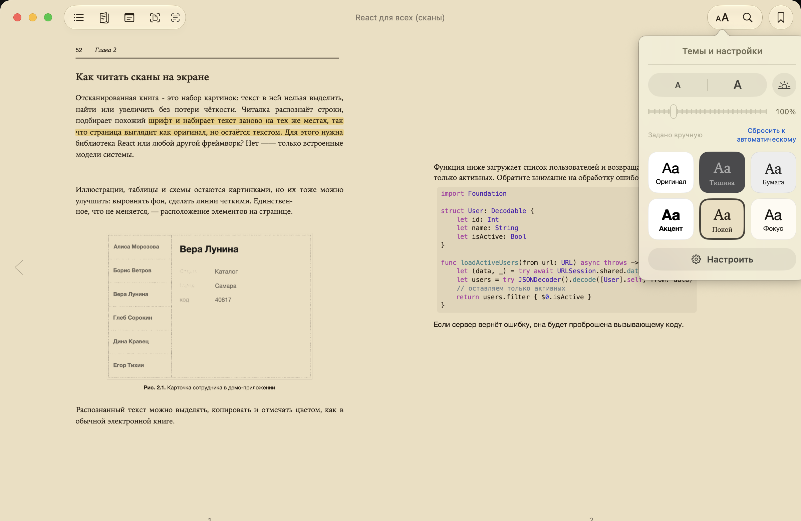
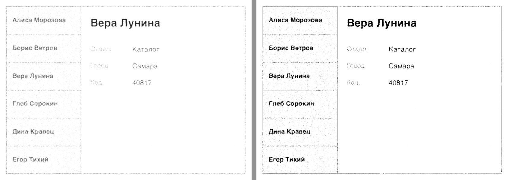

# Lumen Reader

**A macOS reader in the spirit of Apple Books that turns scanned books into real text.**
Scanned pages are recognized with the on-device Vision models, and the text is re-typeset in place
(same lines, fonts matched to the scan), so a scan reads like an e-book — while the original is one click away.

Website: [ai-soft.app](https://ai-soft.app) · [Русская версия](README.ru.md)



| Scanned page, re-typeset, with highlights | EPUB with highlights |
|---|---|
|  |  |
| **Welcome tour** | |
|  | |
| **Themes & settings** | **Scan enhancement (before / after)** |
|  |  |

## Features

- **OCR for scans** (PDF, image folders, single images) with Apple Vision, many languages; everything runs on device.
- **Layout-preserving re-typesetting**: baselines, alignment, bold/italic, serif/sans and point size matched to the scan;
  figures and rules are kept; code blocks get a monospaced font, indentation and syntax highlighting.
- **Reflow** at any text size (50–300%): paragraphs re-flow with hyphenation; words hyphenated in the original
  are joined back (dictionary-checked), figures and code stay in the flow. Automatic text size from the physical screen DPI.
- **Original on demand**: show the scan for a page (or automatically when recognition is unreliable), with
  enhancement — even background, crisp table lines, contrast.
- **EPUB** with Books-like pagination, themes, fonts, TOC, search.
- **Highlights & notes** (5 colors + underline) on scans and EPUB, a Notes panel, bookmarks.
- **Library** like Apple Books: covers, collections, progress, import from Apple Books (your own PDF/EPUB; DRM books are listed, not imported).
- **iCloud sync without a server**: the library is a folder (e.g. a shared iCloud Drive folder); recognition cache,
  covers, progress and highlights live next to each book in `.scanreader/` and merge across devices and Apple IDs.
- Background recognition of the whole book while idle (paused on low battery), cancellable per book.

## Requirements

- macOS 26 Tahoe or later
- Xcode 16+ / Swift 6 toolchain

## Build & run

```bash
swift build -c release          # build
swift test                      # tests
scripts/make-app.sh             # build Lumen Reader.app into ~/Applications and sign it
```

`make-app.sh` signs with an “Apple Development” certificate from your keychain if present, otherwise ad-hoc.
The product name and bundle id live in [`product.env`](product.env); `scripts/rename.sh NewName` renames everything.

Demo content (synthetic pages, a small library with an EPUB) can be regenerated:

```bash
swiftc -O scripts/make-demo-scan.swift -o /tmp/mds && /tmp/mds demo/synthetic-page.png
swiftc -O scripts/make-demo-cover.swift -o /tmp/cover && python3 scripts/make-demo-library.py /tmp/cover
```


## Updates & releases

The app updates itself with [Sparkle 2](https://sparkle-project.org) (menu **Check for Updates…**, automatic checks in Settings).
The signed feed lives in GitHub Releases; the feed URL and the public EdDSA key are set in `product.env`.

`scripts/release.sh 0.2` builds, signs, packages a DMG and generates a signed `appcast.xml` in `build/`,
then prints the `gh release create` command — it never publishes by itself. The private Sparkle key stays in the
Keychain (account = bundle id) or in the `LUMENREADER_SPARKLE_PRIVATE_KEY` secret for the manual
[Release workflow](.github/workflows/release.yml).

## Limitations

- Prototype quality; recognition quality depends on the scan. Complex multi-column layouts and math are not re-typeset.
- Importing collections and reading progress from Apple Books requires Full Disk Access.
- DRM-protected books (Book Store purchases) cannot be opened.
- Super-resolution for scans uses a Core ML model only if you install one
  (`~/Library/Application Support/Lumen Reader/Models/SuperResolution.mlmodelc`).

## Support

You can support development through [GitHub Sponsors](https://github.com/sponsors/evn88).

## License

[MIT](LICENSE)
