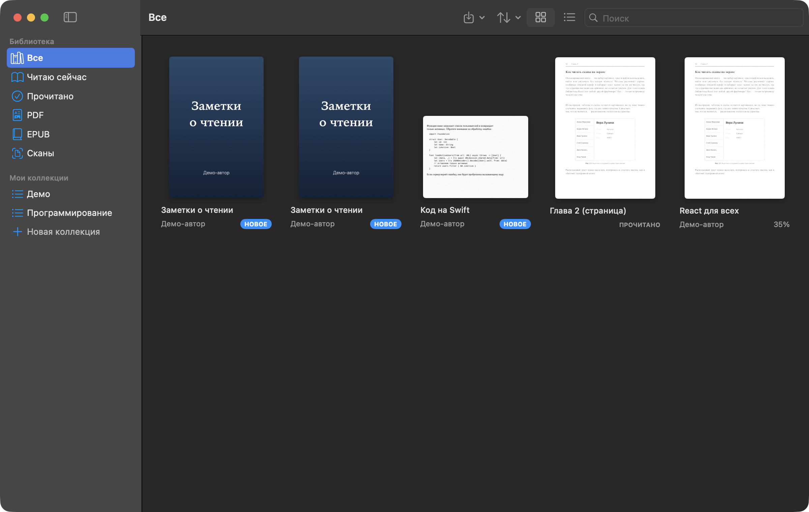
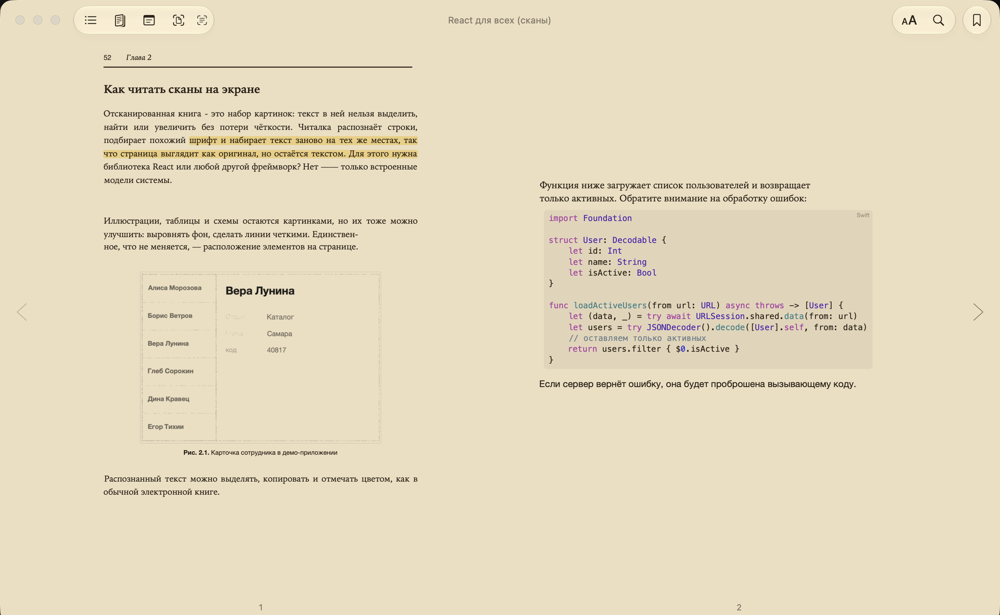
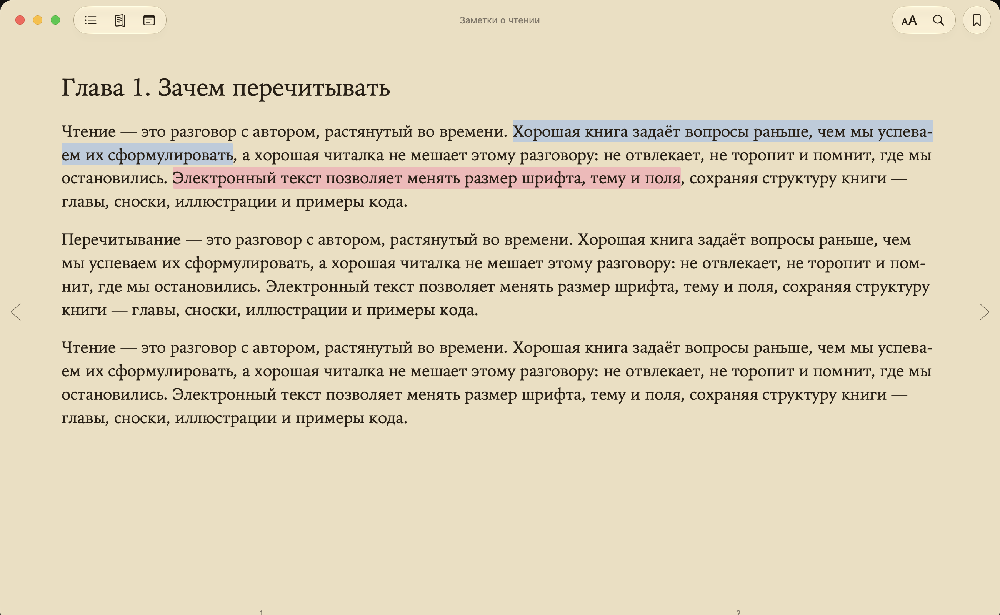
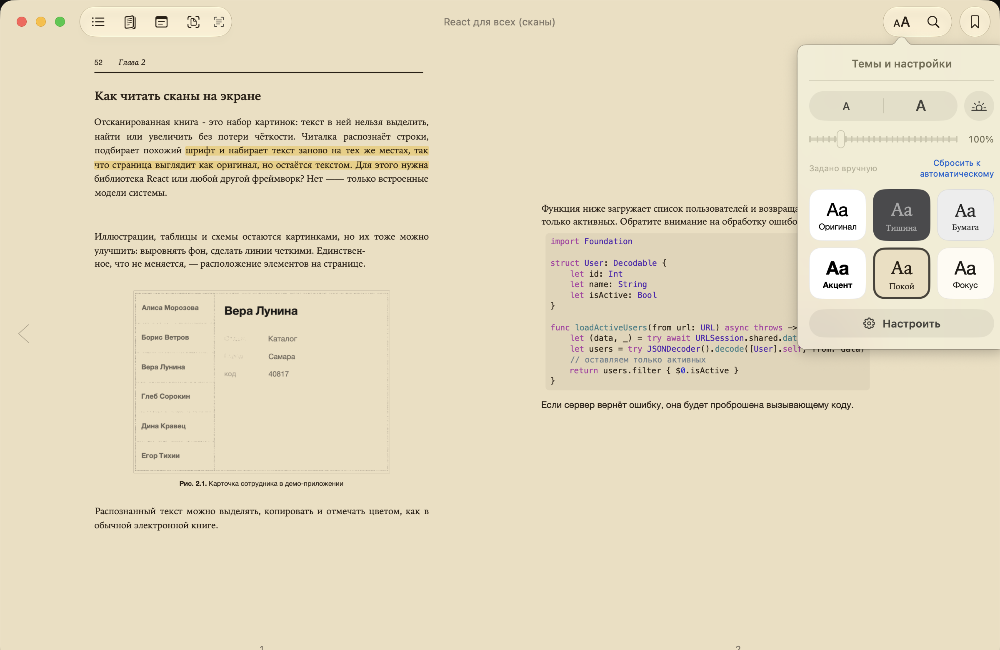
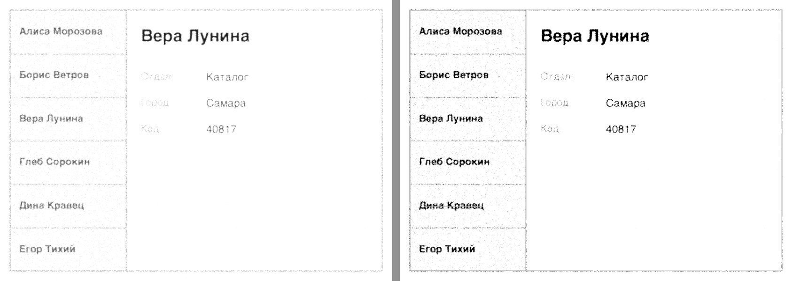

# Lumen Reader

**Читалка для macOS в духе Apple Books, которая превращает сканы книг в настоящий текст.**
Страницы распознаются встроенными моделями Vision, и текст заново набирается на тех же местах
(те же строки, шрифты подобраны под скан): скан читается как электронная книга, а оригинал — в один клик.

Сайт: [ai-soft.app](https://ai-soft.app) · [English version](README.md)



| Скан, набранный заново, с хайлайтами | EPUB с хайлайтами |
|---|---|
|  |  |
| **Темы и настройки** | **Улучшение скана (до / после)** |
|  |  |

## Возможности

- **Распознавание сканов** (PDF, папки картинок, отдельные изображения) через Apple Vision, много языков, всё на устройстве.
- **Набор с сохранением вёрстки**: базовые линии, выравнивание, жирный/курсив, антиква/гротеск и кегль как в скане;
  иллюстрации и линейки остаются; блоки кода — моноширинным шрифтом с отступами и подсветкой синтаксиса.
- **Перекомпоновка** при любом размере текста (50–300%): абзацы переносятся заново с переносами, слова, перенесённые
  в оригинале, склеиваются (с проверкой по словарю), иллюстрации и код остаются в потоке. Автоматический размер
  текста по физической плотности экрана.
- **Оригинал по запросу**: показ скана страницы (или автоматически при ненадёжном распознавании) с улучшением —
  ровный фон, чёткие линии таблиц, контраст.
- **EPUB** с постраничной разбивкой как в Books, темами, шрифтами, оглавлением и поиском.
- **Хайлайты и заметки** (5 цветов + подчёркивание) на сканах и в EPUB, панель «Заметки», закладки.
- **Библиотека** как в Apple Books: обложки, коллекции, прогресс, импорт из Apple Books (свои PDF/EPUB; книги с DRM показываются списком).
- **Синхронизация через iCloud без сервера**: библиотека — это папка (например, общая папка iCloud Drive); кеш распознавания,
  обложки, прогресс и хайлайты лежат рядом с каждой книгой в `.scanreader/` и сливаются между устройствами и Apple ID.
- Фоновое распознавание всей книги в простое (пауза на низком заряде), отмена при закрытии книги.

## Требования

- macOS 14+ (Liquid Glass и новейшие модели Vision — на macOS 26+)
- Xcode 16+ / Swift 6

## Сборка и запуск

```bash
swift build -c release          # сборка
swift test                      # тесты
scripts/make-app.sh             # Lumen Reader.app в ~/Applications с подписью
```

`make-app.sh` подписывает сертификатом «Apple Development» из связки ключей, если он есть, иначе ad-hoc.
Название продукта и bundle id — в [`product.env`](product.env); `scripts/rename.sh НовоеИмя` переименует всё.

Демо-контент (синтетические страницы, небольшая библиотека с EPUB) пересоздаётся так:

```bash
swiftc -O scripts/make-demo-scan.swift -o /tmp/mds && /tmp/mds demo/synthetic-page.png
swiftc -O scripts/make-demo-cover.swift -o /tmp/cover && python3 scripts/make-demo-library.py /tmp/cover
```


## Обновления и релизы

Приложение обновляется через [Sparkle 2](https://sparkle-project.org) (меню «Проверить обновления…», автопроверка в настройках).
Подписанная лента лежит в GitHub Releases; адрес ленты и публичный EdDSA-ключ — в `product.env`.

`scripts/release.sh 0.2` собирает, подписывает, упаковывает DMG и генерирует подписанный `appcast.xml` в `build/`,
затем печатает команду `gh release create` — сам ничего не публикует. Приватный ключ Sparkle хранится в Keychain
(аккаунт = bundle id) или в секрете `LUMENREADER_SPARKLE_PRIVATE_KEY` для ручного
[workflow релиза](.github/workflows/release.yml).

## Ограничения

- Прототип; качество зависит от скана. Сложная многоколоночная вёрстка и формулы заново не набираются.
- Для импорта коллекций и прогресса из Apple Books нужен «Полный доступ к диску».
- Книги с DRM (покупки в Book Store) не открываются.
- Super-resolution для сканов — только если установлена модель Core ML
  (`~/Library/Application Support/Lumen Reader/Models/SuperResolution.mlmodelc`).

## Поддержка

Поддержать разработку можно через [GitHub Sponsors](https://github.com/sponsors/evn88).

## Лицензия

[MIT](LICENSE)
